# AARAJ production hosting and release architecture

Status: approved target architecture; production implementation is not yet
qualified. This document records the first site's approved hosting and release
model on the existing Contabo VPS. It does not assert that VPS access, SSH key
authorization, or deployment have been verified.

## Hosting baseline

- The existing Contabo VPS runs Ubuntu 24.04 LTS and hosts multiple sites.
- Shared Nginx is the public reverse proxy. Nginx configuration and TLS
  certificate management are administrator-owned and outside an AARAJ release.
- Each site has a dedicated Linux service user. AARAJ's NestJS API and Next.js
  storefront run as that site user under PM2. Start with exactly one API
  instance: API workers are internal to that process and must not be duplicated
  by PM2 cluster mode or a second worker process.
- Bind application listeners to loopback. Nginx terminates Let's Encrypt HTTPS
  and proxies storefront traffic to the local Next.js listener. Next.js keeps
  the existing same-origin `/api/*` rewrite to
  `API_INTERNAL_URL=http://127.0.0.1:3001`; the API listener is not publicly
  exposed.
- Use PostgreSQL 16 with per-site databases and roles. Keep a separate,
  restricted migration role and runtime role. Production PostgreSQL TLS must
  verify the server certificate and hostname; keep the CA file on the VPS and
  preserve the application's `rejectUnauthorized: true` policy.
- Keep Redis private to the host/network. Give each site its own Redis ACL
  identity and key namespace. Configure AARAJ's Better Auth, cart, throttling,
  and catalog-cache prefixes explicitly, then limit the ACL key patterns to
  those AARAJ prefixes. Do not expose Redis publicly.
- Store AARAJ production secrets on the VPS in root-managed files with narrow
  ownership and permissions. The API alone receives runtime secrets; the
  storefront does not receive database or provider credentials. Keep the
  public canonical origin in `/etc/sites/aaraj/site.env`; it is the only value
  shared with the storefront process. Migration credentials are separately
  available only to the migration service. GitHub receives neither database
  password.
- Run PM2 under `aaraj-pm2.service`, with one forked API and one storefront
  process under Linux identity `aaraj`. The API reads `/etc/sites/aaraj/runtime.env`
  through Node's `--env-file`. Systemd loads the non-secret
  `/etc/sites/aaraj/site.env` and passes `CLIENT_URL` to both processes for
  auth/CSRF origin checks and canonical metadata; the storefront also receives
  only its internal API origin and other non-secret runtime settings. Rotate
  PM2 logs with logrotate.
- Keep release directories owned by `aaraj-deploy:aaraj-code` mode `2750`;
  application and migration identities receive read-only group access. The
  deployment account extracts and activates releases without a root installer.
- Provision `/srv/sites/aaraj` as `root:aaraj-code` mode `2750` and `releases`
  as `aaraj-deploy:aaraj-code` mode `2750`; keep `shared` as `root:aaraj-code`
  mode `2750`, the shared Next.js cache as `root:aaraj` mode `2770`, and
  `incoming` as `aaraj-deploy:aaraj-deploy` mode `0700`.
  Add the app, migration, and deployment identities to `aaraj-code` as needed.
  Keep `/etc/sites/aaraj` root-managed. Use owner `root:aaraj` and mode `0640`
  for `runtime.env` and `site.env`; use `root:aaraj-migrate` and mode `0640`
  for `migration.env`. The site env contains only `CLIENT_URL`, never credentials.
  Before enabling this unit on an existing host, create `site.env` from the
  currently configured public origin, remove `CLIENT_URL` from `runtime.env`,
  install the updated unit, run `systemctl daemon-reload`, then restart PM2.
- Serve the apex hostname as canonical. Redirect `www` and HTTP requests to the
  canonical HTTPS origin; the TLS certificate must cover both hostnames.
- Do not install a persistent GitHub Actions runner on the production VPS.

```mermaid
flowchart LR
  PR[Pull request] --> CI[GitHub-hosted CI]
  CI --> Review[Review and merge to main]
  Review --> Build[Main push runs CI and builds exact commit]
  Build --> Artifact[Artifact smoke tests]
  Artifact --> MGate{Migration changes?}
  MGate -->|yes| Compat[CI runs migration compatibility checks]
  MGate -->|no| Gate[AARAJ production environment]
  Compat --> Gate
  Gate --> Pathao[Provision validated Pathao settings]
  Pathao --> Transfer[Pinned SSH identity and site-scoped transfer]
  Transfer --> Stage["/srv/sites/aaraj/releases/{commit}-{artifact-sha256}"]
  Stage --> RunMigration[CI/CD runs the exact release migration service on the VPS]
  RunMigration --> Activate
  Activate[Atomic activation]
  Activate --> Health[API, storefront, and HTTPS health checks]
  Health -->|pass| Success[Release successful]
  Health -->|fail| Failure[Leave release active and deploy a corrective release]
```



## Mandatory GitHub Actions policy

GitHub Actions is the only routine production deployment path. Pull requests
run CI before merge. Each push to `main` runs the same CI checks and builds and
smoke-tests that exact commit. Compatible releases can deploy through the
`aaraj-production` environment; maintenance migrations require a manual
dispatch for the exact SHA. Publishing a GitHub
Release page is optional and does not trigger another deployment. Configure
the `aaraj-production` environment for `main` and scope the SSH credential to
the deploy job.

Verify the `aaraj-production` environment's branch restriction, secrets, and
review settings in GitHub before production use. The repository's branch
protection settings are not verified by this document. Until protection and
review rules are confirmed, write access to `main` is the effective production
release authority. See GitHub's documentation for [deployment environments](https://docs.github.com/en/actions/how-tos/deploy/configure-and-manage-deployments/manage-environments)
and [protected branches](https://docs.github.com/en/repositories/configuring-branches-and-merges-in-your-repository/managing-protected-branches).

Use GitHub-hosted `ubuntu-24.04` x64 runners for CI and deployment builds. Set up
Node.js `24.22.1` and pnpm `12.15.0` explicitly and assert both versions in the
workflow. The repository's current engine range is `>=24.15.0 <25`; the pinned
Node.js release is the current Node 24 LTS patch selected for production builds.
Pin every GitHub Action to a full commit SHA. Keep workflow permissions
read-only except for permissions strictly needed to attest or upload the
release artifact.

The main-push workflow builds one artifact from the exact verified commit and
smoke-tests it before deployment; build jobs have no production environment
secrets. The `aaraj-production` environment scopes the per-site SSH credential
to the deploy job. After CI and artifact checks pass, CI/CD validates and
provisions Pathao runtime settings, stages the artifact, starts the exact
artifact's migration service through the narrow root-owned wrapper, waits for
it to finish, then activates and health-checks the app. Routine migrations can
proceed automatically after compatibility checks. Maintenance migrations
require an exact-SHA manual dispatch. That confirms operator intent; it is not
an independent review.
The workflow uses an AARAJ concurrency group with cancellation disabled. A
second deployment cannot overlap an active deployment to the same site. Until
repository review controls are confirmed, write access to `main` is the
effective production release authority.

Keep production database secrets on the VPS. Store the dedicated
AARAJ deployment private key, pinned VPS `known_hosts` entry, and any qualified
Pathao credentials in the GitHub `aaraj-production` environment. Use strict
OpenSSH host-key checking with the independently verified host key installed
before deployment.
Never accept an unverified `ssh-keyscan`, disable host-key checking, use the
human administrator key, or expose root SSH credentials. The key maps to the
unprivileged `aaraj-deploy` account. It can write only AARAJ's incoming and
release directories. Its narrow sudo permissions restart
`aaraj-pm2.service` and invoke the root-owned
`aaraj-start-migration` wrapper with a commit SHA; that wrapper accepts only a
validated staged AARAJ release. The account cannot modify shared Nginx
configuration, read runtime or migration secrets, or target another site's
paths. No custom SSH gateway or second migration SSH identity is used. The
deployment helper verifies and safely extracts the artifact and fixes all
operations to `/srv/sites/aaraj`.

Human administration uses each operator's named, non-root Linux account, an
individual passphrase-protected Ed25519 SSH key, and `sudo` for privileged
work. Keep root SSH login and SSH password authentication disabled after the
key login and `sudo` path have both been verified. Keep the Contabo web console
available as the break-glass path. Bootstrap or repair the account through
that console or an existing trusted administrator; test a second SSH session,
`sudo`, and console access before changing SSH authentication settings. This
host access path is a target procedure and has not been verified on the VPS.

Install the dedicated public key in
`/home/aaraj-deploy/.ssh/authorized_keys`. Keep the home directory, `.ssh`
directory, and `authorized_keys` root-owned and not writable by the deployment
account; for example, use `root:root` with modes `0755`, `0755`, and `0644`.
This lets OpenSSH read the key while preventing a compromised deployment
account from adding another login key. Keep `StrictModes` enabled and prefix
the authorized-key entry with `restrict`. Never install the administrator's
key or place the deployment private key on the VPS.

```text
restrict ssh-ed25519 <AARAJ_DEPLOY_PUBLIC_KEY> aaraj-github-actions
```

## Release artifact and activation

Build only the verified `main` commit once for production packaging, without
production secrets or access to the production database. Keep the existing
lockfile frozen. Build `@aaraj/contracts` first, then the API and storefront.
Package the API as a
portable production dependency tree with pnpm's filtered deploy command; add
the Nest build output, Drizzle SQL migration files, and the production
migration entry point explicitly. Build Next.js in standalone mode with the
monorepo root available to output-file tracing, and package its standalone
server, traced dependencies, `.next/static`, and `public` assets. Preserve
Linux x64/glibc native dependencies such as `sharp` by building on the same
Ubuntu release and architecture as the VPS. The API and storefront artifact
must start from the packaged paths after extraction without running pnpm or
building source on the VPS.

Build with the internal API origin used at runtime,
`API_INTERNAL_URL=http://127.0.0.1:3001`; this is configuration, not a secret.
Keep PostgreSQL, Redis, authentication, storage, and provider credentials out
of the artifact. Emit a release manifest containing the stable release
baseline tag, commit SHA, lockfile hash, Node/pnpm versions, and Ubuntu runner
platform/architecture. The baseline tag preserves compatibility with the
installed host validator. A new stable version tag is needed after a
migration-bearing deployment to advance the migration comparison baseline;
code-only deployments do not require a new tag.
Normalize archive ordering and timestamps and use the commit SHA as the Next.js
build ID. CI checks the final archive digest, extracts it into a clean
directory, imports the packaged runtime dependencies, and smoke-tests the API,
storefront, PostgreSQL, Redis, and same-origin API rewrite. The production
artifact is built once and transferred by checksum; do not rebuild on or
upload source to the VPS. This first implementation does not run a second
compiler build solely to compare build outputs.

The host stores staged releases under
`/srv/sites/aaraj/releases/<commit>-<artifact-sha256>`, so different artifacts
from one commit can coexist before activation. The site-specific unprivileged
helper verifies the transferred digest, rejects unsafe archive entries,
extracts into a temporary AARAJ release directory, and atomically renames the
staged release into place. Activation switches
`/srv/sites/aaraj/releases/current`, restarts PM2, and removes inactive release
directories. The `aaraj` process can read release code but cannot write it.
Runtime cache and logs go to site-owned writable locations. The shared Next.js
cache is writable by the `aaraj` runtime group; the deployment identity has no
write permission outside incoming and releases.
PM2 runs the API as one forked instance and the storefront as one process, both
under AARAJ's service identity.

After activation, check the storefront and `/api/health/ready` through public
HTTPS and Nginx. API readiness confirms PostgreSQL and Redis connectivity.
Mark the release successful only after all checks pass. If health checks fail,
the deployed release remains active and the GitHub job fails. Review service
and migration logs, then deploy a corrective release.

## Drizzle migration gate

The production workflow compares migration files with the latest earlier stable
release tag in the deployed commit's history. Apply the next stable version tag
to the exact commit after a successful migration-bearing deployment; this
advances the migration comparison baseline. A GitHub Release page is optional,
and code-only deployments do not need a new version tag. Each new migration
must have an entry in `infrastructure/production/migration-impact.json`:
`compatible` means an online, backward-compatible change; `maintenance` means
a data rewrite/backfill, destructive change, locking DDL that needs an
operator window, or a change that requires coordinated application updates.
Missing or invalid entries fail the release gate. The gate does not infer risk
from SQL keywords.
Existing numbered migrations are immutable after release. Use
expand-and-contract changes so the schema remains compatible with the active
and previous app release; test both app versions where a schema change requires
it.

A migration-bearing deployment passes the same migration compatibility tests
before the deploy job runs. After the artifact is staged, CI/CD uses a
root-owned wrapper to start
`aaraj-migration@<commit>-<artifact-sha256>.service` for that exact staged
artifact. Distinct artifacts from one commit receive separate migration units.
Drizzle does nothing when the schema is current; the runner still reconciles
runtime grants. `systemctl start` waits for the oneshot service to finish, and
a nonzero result stops activation. The wrapper accepts only a commit SHA and
artifact digest, then selects the corresponding fixed migration unit.
The service runs as
`aaraj-migrate`, loads credentials from `/etc/sites/aaraj/migration.env`,
verifies PostgreSQL TLS with the existing `rejectUnauthorized: true` helper,
and uses the role separate from the runtime account. GitHub never receives
production database credentials. Before execution, the runner checks the
staged clean release SHA, Drizzle journal order, migration hashes and applied
timestamps, and takes an advisory lock. After applying migrations, the service
reconciles runtime table grants from the checked-in `db:grant-runtime` policy
before the release can activate.

Keep this small host-local wrapper for a specific Drizzle ORM limitation: the
pinned PostgreSQL migrator compares each journal timestamp only with the latest
database timestamp when deciding which migration to apply. It does not compare
the complete previously applied history with the packaged migration hashes or
take a cross-process migration lock. The wrapper still delegates SQL execution
and Drizzle history writes to Drizzle's existing migrator, while checking the
full history and serializing execution. Compatibility remains the
responsibility of CI tests and pull-request review. The systemd oneshot keeps
migration credentials isolated from the API, applies a service sandbox, and
records execution in the host journal.

CI migration compatibility tests precede production migration and activation.
Design routine migrations to preserve compatibility with the previous app
version. A `maintenance` classification requires an exact commit SHA confirmed
through `workflow_dispatch`. That confirmation is not an independent review
until the repository's review rules are verified in GitHub.

### Initial schema bootstrap

1. After the host preflight, an administrator creates the isolated AARAJ
   database, restricted runtime role, and separate migration role. The
   migration role owns only AARAJ database/schema objects it needs; do not use
   a shared-site or superuser credential for the application.
2. Install the verified PostgreSQL CA on the VPS and populate the site,
   protected runtime, and migration environment files from their checked-in
   examples. Set the canonical apex HTTPS origin in `site.env` and
   `BETTER_AUTH_URL`; point `www` DNS to the host and include it in the TLS
   certificate. Confirm PostgreSQL certificate and hostname validation from
   the VPS before a migration.
3. From a reviewed repository checkout on the VPS, install or refresh the
   migration helpers as root with
   `bash infrastructure/production/host/install-migration-autostart.sh`.
   On an existing host, do this before using the updated deployment workflow.
   Push the commit to `main`. CI/CD starts the migration unit for the exact
   staged artifact and continues only after successful completion. The runner applies the initial
   journal to the empty AARAJ database and refuses to treat existing AARAJ
   schemas without Drizzle history as a clean database.
4. Verify API readiness and the runtime role's restricted permissions before
   accepting traffic. The migration runner applies the checked-in runtime
   grant policy before activation.

## Failed deployment

1. Record the failed commit, artifact digest, active release ID, migration
   result, service logs, and public health-check output.
2. Review the failure and deploy a corrective commit through the normal
   production workflow. Changes after a completed migration must use a new
   reviewed migration; do not edit or reverse an applied migration.

## Production deployment workflow

| File or setting | Required change |
| --- | --- |
| `.github/workflows/ci.yml` | Run every current check on pull requests and expose the workflow through `workflow_call`; pin Node `24.22.1` and pnpm `12.15.0`, and assert the versions. |
| `.github/workflows/production-release.yml` | On `main` pushes, call CI once, package and smoke-test that exact commit, classify new migration files against the latest stable tag, and deploy through strict pinned SSH with site-only transfer, health checks, and concurrency group `aaraj-production`. |
| `.node-version` | Add `24.22.1` as the repository's exact CI/release Node version. |
| `apps/web/next.config.ts` | Enable standalone output, set `outputFileTracingRoot` to the monorepo root, and use the release SHA for a deterministic Next.js build ID while preserving the current same-origin API rewrite and security headers. |
| `apps/api/scripts/migrate-production.mjs` | Add host-local production migration execution using the shipped Drizzle runtime and migration files, separate migration-role environment variables, the existing strict PostgreSQL TLS helper, and migration journal/checksum checks. Keep the existing local `db:migrate` path intact. |
| `infrastructure/production/package-release.mjs` and `verify-release.mjs` | Build the isolated API deployment tree and Next standalone tree, add only runtime/migration assets and non-secret configuration, generate the manifest/checksum, and verify extracted artifacts start with no workspace paths or omitted runtime files. |
| `infrastructure/production/host/` | Keep the site-scoped deployment script, SHA-validating migration wrapper and one-time installer, narrow sudo allowlist, per-release migration and PM2 systemd units, PM2 ecosystem, log rotation, canonical Nginx template, and site-only environment examples. Install host configuration and group-scoped directory permissions during an approved infrastructure phase. |
| `docs/architecture/ecommerce-blueprint.md`, `docs/README.md`, and `README.md` | Point the approved initial-hosting decision and engineering portal to this operational architecture. |
| GitHub repository settings | Keep deployment variables and the dedicated deployment key and verified host-key pin scoped to `aaraj-production`; verify its `main` restriction and available review/protection rules. |

The production workflow must prove the API deploy output contains the
built `@aaraj/contracts` runtime package and every API production dependency,
including native packages; prove the Next standalone artifact contains its
traced monorepo dependencies and static assets; extract the final archive into
a clean directory and run API/web health checks against disposable PostgreSQL
16 and Redis services. The workflow deliberately builds the deployable artifact
once; it does not perform a second compiler build solely for comparison.

## Implementation gates

1. **SSH authorization and recovery:** identify the human administrator key,
   install its public key only through an authorized path, prove key-only
   administrator login, and verify Contabo recovery-console access.
2. **Host preflight:** verify Ubuntu 24.04, CPU architecture, disk and memory,
   firewall, Nginx ownership, existing sites/processes, PostgreSQL 16 and
   verified TLS, private Redis isolation, apex/`www` DNS and TLS prerequisites,
   and production database connectivity. No host changes before this gate passes.
3. **Repository release implementation:** add and qualify the workflow,
   packaging, migration gate, host-scoped deployment helper, and health checks.
   Production credentials and deployment access stay
   out of pull-request jobs.
4. **AARAJ host provisioning:** create only AARAJ-owned accounts, paths,
   database/Redis isolation, Nginx site configuration, certificate, and
   secrets; do not alter unrelated sites.
5. **First controlled release:** push a commit to `main`, let CI/CD migrate,
   activate, and verify it, then confirm the live health checks.

## Upstream implementation references

- [GitHub Actions deployment environments](https://docs.github.com/en/actions/concepts/workflows-and-actions/deployment-environments)
- [pnpm deploy](https://pnpm.io/cli/deploy)
- [Next.js standalone output and monorepo tracing](https://nextjs.org/docs/app/api-reference/config/next-config-js/output)
- [actions/setup-node version syntax](https://github.com/actions/setup-node#supported-version-syntax)
