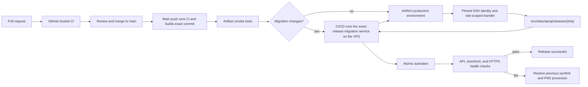

# AARAJ production hosting and release architecture

Status: approved target architecture; production implementation is not yet
qualified. This document records the first site's approved hosting and release
model on the existing Contabo VPS. It does not assert that VPS access, SSH key
authorization, backups, recovery access, or deployment have been verified.

## Hosting baseline

- The existing Contabo VPS runs Ubuntu 24.04 LTS and hosts multiple sites.
- Shared Nginx is the public reverse proxy. Nginx configuration and TLS
  certificate management are administrator-owned and outside an AARAJ release.
- Each site has a dedicated Linux service user. AARAJ's NestJS API and Next.js
  storefront run as that site user under PM2. Start with exactly one API
  instance: API workers are internal to that process and must not be duplicated
  by PM2 cluster mode or a second worker process.
- Bind application listeners to loopback. Nginx terminates Let's Encrypt HTTPS
  and proxies storefront traffic to the local Next.js listener. Next.js keeps
  the existing same-origin `/api/*` rewrite to
  `API_INTERNAL_URL=http://127.0.0.1:3001`; the API listener is not publicly
  exposed.
- Use PostgreSQL 16 with per-site databases and roles. Keep a separate,
  restricted migration role and runtime role. Production PostgreSQL TLS must
  verify the server certificate and hostname; keep the CA file on the VPS and
  preserve the application's `rejectUnauthorized: true` policy.
- Keep Redis private to the host/network. Give each site its own Redis ACL
  identity and key namespace. Configure AARAJ's Better Auth, cart, throttling,
  and catalog-cache prefixes explicitly, then limit the ACL key patterns to
  those AARAJ prefixes. Do not expose Redis publicly.
- Store AARAJ production secrets on the VPS in root-managed files with narrow
  ownership and permissions. The API alone receives runtime secrets; the
  storefront does not receive database or provider credentials. Migration
  credentials are separately available only to the migration service. GitHub
  receives neither database password.
- Run PM2 under `aaraj-pm2.service`, with one forked API and one storefront
  process under Linux identity `aaraj`. The API reads `/etc/sites/aaraj/runtime.env`
  through Node's `--env-file`; the web process receives only its internal API
  origin and non-secret runtime settings. Rotate PM2 logs with logrotate.
- Keep release directories owned by `aaraj-deploy:aaraj-code` mode `2750`;
  application and migration identities receive read-only group access. The
  deployment account extracts and activates releases without a root installer.
- Provision `/srv/sites/aaraj` as `root:aaraj-code` mode `2750` and `releases`
  as `aaraj-deploy:aaraj-code` mode `2750`; keep `shared` as `root:aaraj-code`
  mode `2750`, the shared Next.js cache as `root:aaraj` mode `2770`, and
  `incoming` as `aaraj-deploy:aaraj-deploy` mode `0700`.
  Add the app, migration, and deployment identities to `aaraj-code` as needed.
  Keep `/etc/sites/aaraj` root-managed; the
  runtime and migration env files have separate groups and mode `0640`.
- Store encrypted backups offsite and document a tested restore path.
- Do not install a persistent GitHub Actions runner on the production VPS.

## Encrypted backup and restore

Use a dedicated offsite object-storage bucket and a client-side encrypted
backup repository such as restic. Keep its repository credentials separate
from AARAJ media credentials, with the repository password stored root-only on
the VPS and escrowed outside the VPS. Back up a PostgreSQL 16 custom-format
dump through certificate-verified TLS and the AARAJ backup role. Include the
protected `/etc/sites/aaraj/` configuration in the encrypted repository, with
access to restored secrets limited to the administrator. Do not send backup
credentials or database passwords to GitHub Actions.

Before a migration-bearing production deployment, maintain a recent successful
database backup. Schedule repository integrity checks and restore drills; verify
a restore into a separate empty database before declaring the backup usable.
Recover by restoring to a new database and validating the application before
switching production, not by overwriting the existing database as a first
step. The restic repository format is encrypted, and its
`check` and restore commands are documented by the [restic project](https://restic.readthedocs.io/en/stable/).

Backup destination, credentials, retention, recovery objectives, automation,
and a successful restore drill remain unconfigured and are production-readiness
blockers. Redis backup/restore requirements must be based on whether its
current AARAJ data is reconstructible or represents user state.



## Mandatory GitHub Actions policy

GitHub Actions is the only routine production deployment path. Pull requests
run CI before merge. Each push to `main` runs the same CI checks, builds and
smoke-tests that exact commit, then
deploys through the `aaraj-production` environment. Publishing a
stable GitHub Release is optional and does not trigger another deployment.
The deploy job receives the environment-scoped SSH credential only after the
checks pass.

Use GitHub-hosted `ubuntu-24.04` x64 runners for CI and deployment builds. Set up
Node.js `24.20.0` and pnpm `12.5.1` explicitly and assert both versions in the
workflow. The repository's current engine range is `>=24.15.0 <25`; the pinned
Node.js release is the current Node 24 LTS patch selected for production builds.
Pin every GitHub Action to a full commit SHA. Keep workflow permissions
read-only except for permissions strictly needed to attest or upload the
release artifact.

The main-push workflow builds one artifact from the exact verified commit and
smoke-tests it before deployment; build jobs have no production environment
secrets. The `aaraj-production` environment scopes the per-site SSH credential
to the deploy job. After CI and artifact checks pass, CI/CD stages the
artifact, starts the exact commit's migration service through the narrow
root-owned wrapper, waits for it to finish, then activates and health-checks
the app. Migrations run automatically; no administrator needs to start them
manually. The workflow
uses an AARAJ concurrency group with cancellation disabled. A second
deployment cannot overlap an active deployment to the same site.

Production secrets in GitHub are limited to the dedicated AARAJ deployment
private key and the pinned VPS `known_hosts` entry. Use strict OpenSSH host-key
checking with the independently verified host key installed before deployment.
Never accept an unverified `ssh-keyscan`, disable host-key checking, use the
human administrator key, or expose root SSH credentials. The key maps to the
unprivileged `aaraj-deploy` account. It can write only AARAJ's incoming and
release directories. Its narrow sudo permissions restart `aaraj-pm2.service`
and invoke the root-owned `aaraj-start-migration` wrapper with a commit SHA;
that wrapper accepts only a validated staged AARAJ release. The account cannot
modify shared Nginx configuration, read runtime or migration secrets, or
target another site's paths. No custom SSH gateway or second migration SSH
identity is used. The
deployment helper verifies and safely extracts the artifact and fixes all
operations to `/srv/sites/aaraj`.

Install the dedicated public key in the deployment account's
`/home/aaraj-deploy/.ssh/authorized_keys` with owner `aaraj-deploy` and mode
`0600`. Prefix its authorized-key entry with `restrict`; never install the
administrator's key or place the deployment private key on the VPS.

```text
restrict ssh-ed25519 <AARAJ_DEPLOY_PUBLIC_KEY> aaraj-github-actions
```

## Release artifact and activation

Build only the verified `main` commit once for production packaging, without
production secrets or access to the production database. Keep the existing
lockfile frozen. Build `@aaraj/contracts` first, then the API and storefront.
Package the API as a
portable production dependency tree with pnpm's filtered deploy command; add
the Nest build output, Drizzle SQL migration files, and the production
migration entry point explicitly. Build Next.js in standalone mode with the
monorepo root available to output-file tracing, and package its standalone
server, traced dependencies, `.next/static`, and `public` assets. Preserve
Linux x64/glibc native dependencies such as `sharp` by building on the same
Ubuntu release and architecture as the VPS. The API and storefront artifact
must start from the packaged paths after extraction without running pnpm or
building source on the VPS.

Build with the internal API origin used at runtime,
`API_INTERNAL_URL=http://127.0.0.1:3001`; this is configuration, not a secret.
Keep PostgreSQL, Redis, authentication, storage, and provider credentials out
of the artifact. Emit a release manifest containing the stable release
baseline tag, commit SHA, lockfile hash, Node/pnpm versions, and Ubuntu runner
platform/architecture. The baseline tag preserves compatibility with the
installed host validator; a new version tag is not required for each deploy.
Normalize archive ordering and timestamps and use the commit SHA as the Next.js
build ID. CI checks the final archive digest, extracts it into a clean
directory, imports the packaged runtime dependencies, and smoke-tests the API,
storefront, PostgreSQL, Redis, and same-origin API rewrite. The production
artifact is built once and transferred by checksum; do not rebuild on or
upload source to the VPS. This first implementation does not run a second
compiler build solely to compare build outputs.

The host stores versioned releases under `/srv/sites/aaraj/releases/<commit>`.
The site-specific unprivileged helper verifies the transferred digest, rejects
unsafe archive entries, extracts into a temporary AARAJ release directory,
and atomically renames the staged release into place. It records the active
release as the previous target and atomically switches
`/srv/sites/aaraj/releases/current`. The previous target is
`/srv/sites/aaraj/releases/previous`. The `aaraj` process can read release code but cannot
write it. Keep current and previous releases; remove older releases only
through a reviewed host maintenance procedure after checking rollback and
migration references. Runtime cache and logs go to site-owned writable
locations. The shared Next.js cache is writable by the `aaraj` runtime group;
the deployment identity has no write permission outside incoming and releases.
PM2 runs the API as one forked instance and the storefront as one process, both
under AARAJ's service identity.

After activation, check the storefront and `/api/health/ready` through public
HTTPS and Nginx. API readiness confirms PostgreSQL and Redis connectivity.
Mark the release successful only after all checks pass. If a release without
migrations fails, atomically restore `current` to the previous release,
restart PM2, verify recovery health, and fail the GitHub job. If a migration
ran, do not automatically restore code because compatibility is unknown; use
the recovery procedure.

## Drizzle migration gate

The production workflow compares migration files with the latest earlier stable
release tag in the deployed commit's history. Release tags remain useful for
versioned milestones, but are not required to deploy each verified `main`
commit. A migration change must pass the existing PostgreSQL 16 fresh-schema
and historical-upgrade compatibility tests. Existing numbered migrations are
immutable after release. Use expand-and-contract changes so the schema remains
compatible with the active and previous app release; test both app versions
where a schema change requires it.

A migration-bearing deployment passes the same migration compatibility tests
before the deploy job runs. After the artifact is staged, CI/CD uses a
root-owned wrapper to start `aaraj-migration@<commit>.service` for that
exact staged release on every deployment. Drizzle does nothing when the schema
is current; the runner still reconciles runtime grants. `systemctl start` waits
for the oneshot service to finish, and a nonzero result stops activation. The
wrapper accepts only a commit SHA and the fixed migration unit.
The service runs as
`aaraj-migrate`, loads credentials from `/etc/sites/aaraj/migration.env`,
verifies PostgreSQL TLS with the existing `rejectUnauthorized: true` helper,
and uses the role separate from the runtime account. GitHub never receives
production database credentials. Before execution, the runner checks the
staged clean release SHA, Drizzle journal order, migration hashes and applied
timestamps, and takes an advisory lock. After applying migrations, the service
reconciles runtime table grants from the checked-in `db:grant-runtime` policy
before the release can activate.

Keep this small host-local wrapper for a specific Drizzle ORM limitation: the
pinned PostgreSQL migrator compares each journal timestamp only with the latest
database timestamp when deciding which migration to apply. It does not compare
the complete previously applied history with the packaged migration hashes or
take a cross-process migration lock. The wrapper still delegates SQL execution
and Drizzle history writes to Drizzle's existing migrator, while checking the
full history and serializing execution. It does not parse SQL or classify
migrations as safe; compatibility remains the responsibility of CI tests and
code review when using pull requests. The systemd oneshot keeps migration credentials isolated from the
API, applies a service sandbox, and records execution in the host journal.

CI migration compatibility tests precede automatic migration and production
activation. Design routine migrations to preserve compatibility with the
previous app version. Plan destructive or rollback-incompatible changes as a
separate maintenance operation with a verified backup and explicit operator
execution. No production database rollback is automatic.
Code rollback is allowed only while the schema is known to remain compatible
with the previous app version.

### Initial schema bootstrap

1. After the host preflight, an administrator creates the isolated AARAJ
   database, restricted runtime role, and separate migration role. The
   migration role owns only AARAJ database/schema objects it needs; do not use
   a shared-site or superuser credential for the application.
2. Install the verified PostgreSQL CA on the VPS and populate the protected
   runtime and migration environment files. Confirm certificate and hostname
   validation from the VPS before a migration.
3. Confirm the database is new and empty, verify the encrypted offsite backup
   destination and restore procedure, and review the initial Drizzle journal
   and SQL in a pull request.
4. From a reviewed repository checkout on the VPS, install the one-time
   permission with `bash infrastructure/production/host/install-migration-autostart.sh`.
   Push the commit to `main`. CI/CD starts `aaraj-migration@<commit>.service` after staging and
   continues only after successful completion. The runner applies the initial
   journal to the empty AARAJ database and refuses to treat existing AARAJ
   schemas without Drizzle history as a clean database.
5. Verify API readiness and the runtime role's restricted permissions before
   accepting traffic. The migration runner applies the checked-in runtime
   grant policy before activation.

## Manual recovery

1. Pause AARAJ releases and record the failed release SHA,
   active symlink, migration journal state, and health-check output.
2. Use the verified human administrator SSH path or Contabo recovery console;
   do not use the GitHub deployment key as an interactive administrator key.
3. If code activation failed and no migration ran, or the schema is confirmed
   backward-compatible, inspect `/srv/sites/aaraj/releases/current` and
   `/srv/sites/aaraj/releases/previous`. With the human administrator account,
   atomically point `releases/current` to the verified previous release and
   restart PM2:

   ```bash
   previous="$(sudo readlink -f /srv/sites/aaraj/releases/previous)"
   sudo bash -eu -c '
     release="$1"
     releases=/srv/sites/aaraj/releases
     [[ "$release" =~ ^/srv/sites/aaraj/releases/[0-9a-f]{40}$ && -d "$release" ]]
     temporary="$(mktemp -d "$releases/.rollback.XXXXXXXX")"
     trap '\''rm -rf -- "$temporary"'\'' EXIT
     ln -s -- "$release" "$temporary/current"
     mv -Tf -- "$temporary/current" "$releases/current"
     rmdir -- "$temporary"
     trap - EXIT
     systemctl restart aaraj-pm2.service
   ' bash "$previous"
   curl --fail https://aarajbd.com/
   curl --fail https://aarajbd.com/api/health/ready
   ```

   Preserve the failed release for investigation.
4. If a migration ran, do not reverse SQL automatically. Keep traffic
   controlled, determine whether the previous app is compatible, and use the
   reviewed forward-fix or database restore plan. Restore only from a verified
   encrypted offsite backup and account for writes since the backup.
5. Record the recovery action and resume releases only after the host and
   database state are understood.

## Production deployment workflow

| File or setting | Required change |
| --- | --- |
| `.github/workflows/ci.yml` | Run every current check on pull requests and expose the workflow through `workflow_call`; pin Node `24.20.0` and pnpm `12.5.1`, and assert the versions. |
| `.github/workflows/production-release.yml` | On `main` pushes, call CI once, package and smoke-test that exact commit, detect migration changes against the latest stable tag, and deploy through strict pinned SSH with site-only transfer, health checks, compatible rollback, and concurrency group `aaraj-production`. |
| `.node-version` | Add `24.20.0` as the repository's exact CI/release Node version. |
| `apps/web/next.config.ts` | Enable standalone output, set `outputFileTracingRoot` to the monorepo root, and use the release SHA for a deterministic Next.js build ID while preserving the current same-origin API rewrite and security headers. |
| `apps/api/scripts/migrate-production.mjs` | Add host-local production migration execution using the shipped Drizzle runtime and migration files, separate migration-role environment variables, the existing strict PostgreSQL TLS helper, and migration journal/checksum checks. Keep the existing local `db:migrate` path intact. |
| `infrastructure/production/package-release.mjs` and `verify-release.mjs` | Build the isolated API deployment tree and Next standalone tree, add only runtime/migration assets and non-secret configuration, generate the manifest/checksum, and verify extracted artifacts start with no workspace paths or omitted runtime files. |
| `infrastructure/production/host/` | Keep the site-scoped deployment script, SHA-validating migration wrapper and one-time installer, narrow sudo allowlist, per-release migration and PM2 systemd units, PM2 ecosystem, log rotation, Nginx template, and site-only environment examples. Install host configuration and group-scoped directory permissions during an approved infrastructure phase. |
| `docs/architecture/ecommerce-blueprint.md`, `docs/README.md`, and `README.md` | Point the approved initial-hosting decision and engineering portal to this operational architecture. |
| GitHub repository settings | Keep deployment variables and the dedicated deployment key and verified host-key pin scoped to the `aaraj-production` environment. |

The production workflow must prove the API deploy output contains the
built `@aaraj/contracts` runtime package and every API production dependency,
including native packages; prove the Next standalone artifact contains its
traced monorepo dependencies and static assets; extract the final archive into
a clean directory and run API/web health checks against disposable PostgreSQL
16 and Redis services. The workflow deliberately builds the deployable artifact
once; it does not perform a second compiler build solely for comparison.

## Implementation gates

1. **SSH authorization and recovery:** identify the human administrator key,
   install its public key only through an authorized path, prove key-only
   administrator login, and verify Contabo recovery-console access.
2. **Host preflight:** verify Ubuntu 24.04, CPU architecture, disk and memory,
   firewall, Nginx ownership, existing sites/processes, PostgreSQL 16 and
   verified TLS, private Redis isolation, DNS/TLS prerequisites, and encrypted
   backup/restore evidence. No host changes before this gate passes.
3. **Repository release implementation:** add and qualify the workflow,
   packaging, migration gate, host-scoped deployment helper, health checks,
   and documented rollback. Production credentials and deployment access stay
   out of pull-request jobs.
4. **AARAJ host provisioning:** create only AARAJ-owned accounts, paths,
   database/Redis isolation, Nginx site configuration, certificate, and
   secrets; do not alter unrelated sites.
5. **First controlled release:** push a commit to `main`, let CI/CD migrate,
   activate, and verify it, then confirm the live health checks and rollback
   target.

## Upstream implementation references

- [GitHub Actions deployment environments](https://docs.github.com/en/actions/concepts/workflows-and-actions/deployment-environments)
- [pnpm deploy](https://pnpm.io/cli/deploy)
- [Next.js standalone output and monorepo tracing](https://nextjs.org/docs/app/api-reference/config/next-config-js/output)
- [actions/setup-node version syntax](https://github.com/actions/setup-node#supported-version-syntax)
