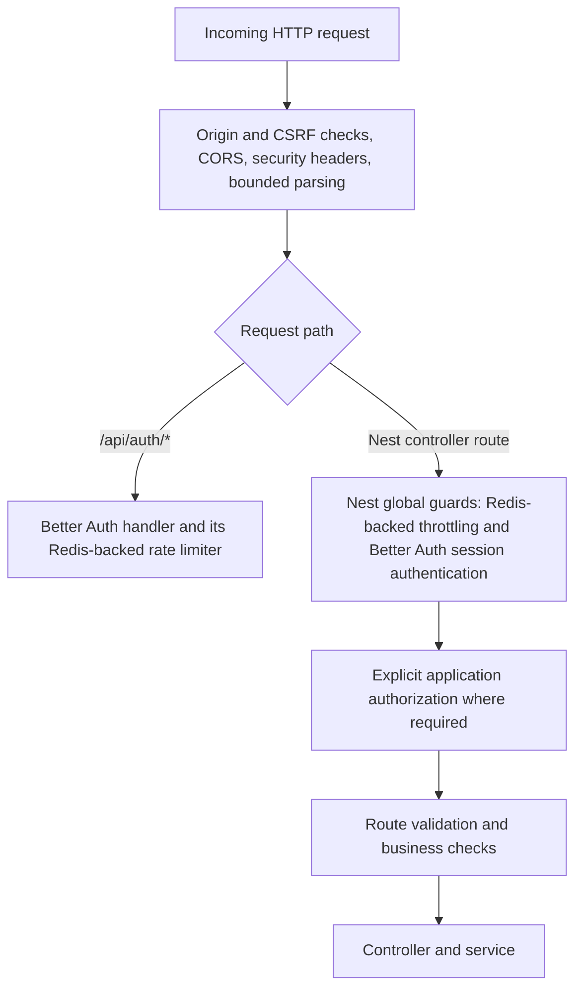

# AARAJ Security Reference

This directory describes the security controls currently used by AARAJ. NestJS's documentation includes both framework controls and a separate `@nestjs/authentication` package. AARAJ uses Better Auth for identity and sessions; it does not run both authentication systems.

| Chapter | AARAJ implementation |
| --- | --- |
| [01 - Authentication](01-authentication.md) | Better Auth email/password, PostgreSQL Drizzle storage, Redis rate-limit storage, and the NestJS adapter |
| [02 - Authorization](02-authorization.md) | NestJS policy checks and persisted application permissions |
| [03 - Encryption & Hashing](03-encryption-hashing.md) | Cryptographic primitives and credential handling |
| [04 - Security Headers](04-security-headers.md) | NestJS security headers and the production response policy |
| [05 - CORS](05-cors.md) | Exact storefront origin and credentialed browser requests |
| [06 - CSRF Protection](06-csrf-protection.md) | NestJS CSRF protection and the Pathao webhook exception |
| [07 - Rate Limiting](07-rate-limiting.md) | Better Auth limits for auth endpoints and Redis-backed NestJS throttling for controller routes |

## Request security map

The diagram separates Better Auth's middleware endpoints from Nest controller routes. It is a scope map, not a promise that every middleware and guard runs in the numbered order shown.

## Current commitments

- Better Auth owns password authentication, session handling, and authentication endpoints. Do not add a second authentication authority or duplicate auth controllers.
- Authentication establishes identity. Application permissions and record-level business rules are checked separately.
- Production browser origins and proxy addresses are explicit. Do not trust caller-supplied forwarded-IP values.
- Both rate limiters use shared Redis-backed storage. Better Auth protects its own endpoints; NestJS Throttler protects Nest controller routes.
- Secrets and submitted credentials are not written to authentication audit records.

References: [NestJS authentication](https://docs.nestjs.com/security/authentication), [NestJS rate limiting](https://docs.nestjs.com/security/rate-limiting), [Better Auth NestJS integration](https://better-auth.com/docs/integrations/nestjs), [Better Auth rate limiting](https://better-auth.com/docs/concepts/rate-limit).

The full NestJS source text supplied for this review is preserved in [official reference snapshots](official-references/README.md).
